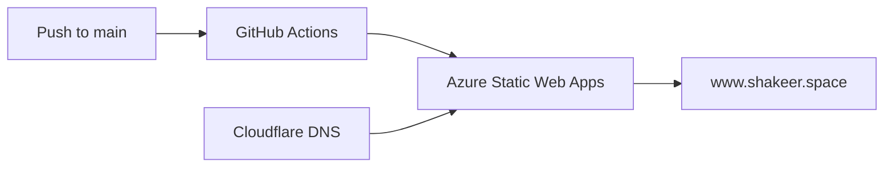

# shakeer.space

Personal portfolio of **Shakeer Ahmad**, Microsoft 365 & Cloud Engineer.

**Live site:** [www.shakeer.space](https://www.shakeer.space)

Plain HTML, CSS and JavaScript with no frameworks and no build step. It's hosted on **Azure Static Web Apps** and deployed by **GitHub Actions** on every push to `main`.

---

## What's on the site

| Page | What it covers |
|---|---|
| `index.html` | About, skills, experience, projects, certifications, contact |
| `details.html` | Longer write-ups: full role details, each project step by step, and case studies |

### Features
- **Interactive terminal:** try `help`, `projects`, `cases` or `sudo hire shakeer`.
- **Quick actions menu:** press <kbd>Ctrl</kbd> / <kbd>⌘</kbd> + <kbd>K</kbd> to jump anywhere.
- **Skill popovers:** hover or tap a skill to see where it was used.
- **Project filters:** M365, Automation, Migration and Cloud.
- **Collapsible write-ups:** the details page shows a short summary first, with an "Expand all" button and copy-link buttons for each project.
- **Contact form:** sends through EmailJS, with a hidden spam-trap field and a timing check.
- **Dark and light themes:** the visitor's choice is saved in `localStorage`.
- **Print-friendly:** printing the home page gives a clean one-page resume.
- **Accessibility:** skip link, keyboard navigation, visible focus styles, and support for reduced motion.
- **A few easter eggs:** triple-click the logo, or try `dattebayo` in the terminal.

---

## Tech stack

| Area | Tools |
|---|---|
| Front end | HTML5, CSS3 (custom properties, grid), vanilla JavaScript |
| Hosting | Azure Static Web Apps |
| CI/CD | GitHub Actions |
| DNS | Cloudflare (custom domain `shakeer.space`) |
| Contact form | EmailJS |
| Fonts & icons | Inter, JetBrains Mono, Noto Sans, Remix Icon |

---

## How it's deployed



1. A commit is pushed or merged to `main`.
2. The Azure Static Web Apps workflow in `.github/workflows/` uploads the site.
3. Cloudflare DNS points the custom domain at the Static Web App, and Azure provides HTTPS.

### Hosting history
The site was first hosted on **AWS**: a private S3 bucket served through CloudFront with Origin Access Control, deployed by GitHub Actions using a least-privilege IAM user. It was then **migrated to Azure Static Web Apps** to simplify hosting and to work hands-on with Azure.

---

## Project structure

```
portfolio/
├── index.html          # Main page
├── details.html        # Long-form experience, projects and case studies
├── css/
│   └── styles.css      # All styles (themes, layout, print)
├── js/
│   └── main.js         # Terminal, palette, filters, popovers, contact form
├── assets/             # Logo, favicons, social preview image, resume.pdf
└── .github/
    └── workflows/      # Azure Static Web Apps deployment
```

---

## Run it locally

There's no build step, so any static file server works:

```bash
git clone https://github.com/Sparkeeer/portfolio.git
cd portfolio

# Option 1: Python
python -m http.server 8000

# Option 2: Node
npx serve .
```

Then open `http://localhost:8000`.

> Opening `index.html` directly from the file system mostly works, but a local server is closer to how the live site behaves.

---

## Configuration

Settings you're most likely to change are at the top of `js/main.js`:

```js
const EMAILJS_SERVICE  = "...";
const EMAILJS_TEMPLATE = "...";
const EMAILJS_KEY      = "...";   // EmailJS public key (safe to expose; restrict it by domain in EmailJS)
const EMAIL            = "...";
const JOB_START        = new Date(2025, 9, 1);
```

After changing CSS or JS, bump the `?v=` number in the HTML `<link>` and `<script>` tags so browsers load the new version.

---

## Contact

- **Email:** ahmad.shakeer.md@gmail.com
- **LinkedIn:** [linkedin.com/in/shakeerahmad05](https://linkedin.com/in/shakeerahmad05)